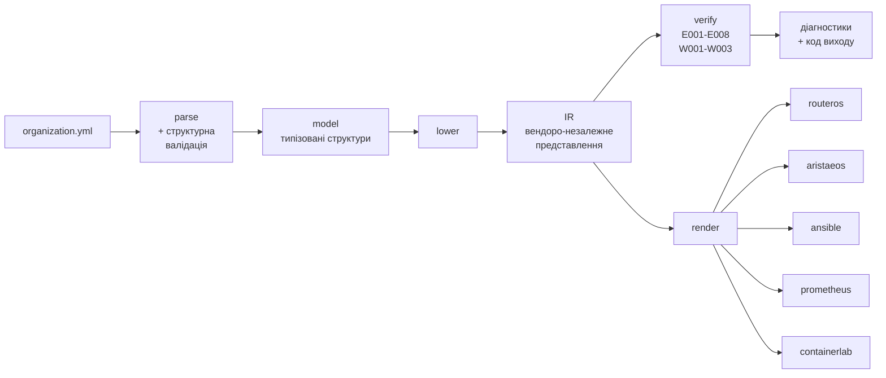
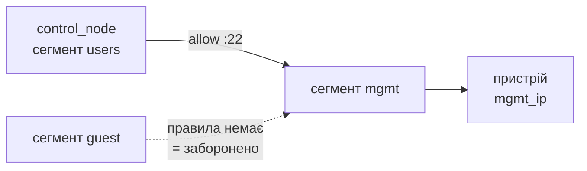

# Архітектура компілятора `orgc`

Продуктову рамку описує [CONCEPT.md](CONCEPT.md).

Мова реалізації — Go. Шлях модуля — `orgc`.

## 1. Принципи

| Принцип | Як реалізується |
|---|---|
| Перевірка до застосування | Семантичні інваріанти обчислюються над моделлю, а не над станом обладнання. Помилка виявляється на етапі компіляції |
| Ядро не знає вендорів | Усі перевірки працюють над проміжним представленням. Знання про платформи ізольоване в бекендах |
| Нічого не застосовується | Компілятор породжує текст і завершується, без мережевих з'єднань і записів на пристрої |
| Детермінованість | Однаковий вхід дає побайтово однаковий вихід. Це предмет окремого експерименту |
| Контракт — це дані | Схема моделі описана як JSON Schema й вбудована в бінарник через `go:embed` |

## 2. Конвеєр



`verify` і `render` працюють над тим самим IR. `render` не запускається, якщо
`verify` знайшов помилки рівня E. Тому згенерована конфігурація завжди
походить із перевіреної моделі.

## 3. Компоненти

### 3.1. `model` — розбір і структурна валідація

Розбирає YAML у типізовані структури Go. Схема вбудована через `go:embed`:
бінарник самодостатній і зовнішніх файлів не потребує.

Структурна валідація лишається за JSON Schema: типи, формати, переліки,
обов'язковість полів. Схема виконує це добре, дублювати ці перевірки в Go
немає підстав.

### 3.2. `lower` — пониження моделі в IR

Перетворює зручний для людини опис у зручне для аналізу представлення:

- імена сегментів розгортаються в посилання на об'єкти;
- CIDR розбираються у числові діапазони, придатні для порівняння;
- правила політик нормалізуються до однорідного вигляду;
- будується граф сегментів, індукований політиками.

Після пониження в IR немає рядків, які треба інтерпретувати: лише структури й
посилання. Завдяки цьому перевірки прості.

### 3.3. `ir` — проміжне представлення

Основні сутності:

- Сегмент — сайт, VLAN ID, префікс як числовий діапазон, роль
  (`mgmt` / `users` / `servers` / `guest`), ознака ізоляції.
- Вузол — пристрій або сервер, прив'язаний до сегмента, з платформою й
  версією операційної системи.
- Ребро політики — впорядкована пара сегментів із множиною портів. Ребро
  існує лише за наявності явного `allow`; відсутність правила означає заборону.
- Вузол керування — сегмент, з якого адміністратор керує інфраструктурою.

IR не містить нічого, специфічного для конкретної платформи. Це умова того, що
інваріанти доводяться один раз для всіх вендорів.

### 3.4. `verify` — інваріанти

Кожен інваріант — окрема функція над IR, що повертає множину діагностик. Реєстр
інваріантів дозволяє вмикати їх вибірково, що потрібно для мутаційного
тестування.

### 3.5. `backend` — генерація

Інтерфейс бекенда мінімальний: на вхід IR, на вихід набір іменованих файлів.
Ядро не знає, які бекенди зареєстровані; додавання нової платформи не змінює
жодного рядка в `verify` або `lower`.

### 3.6. `diag` — діагностики

Єдиний формат для всіх перевірок: код, рівень, повідомлення українською, шлях
до елемента моделі, номер рядка у вихідному YAML.

## 4. E006 — формалізація

Головна перевірка. Формулюється як задача досяжності в орієнтованому графі.

Граф: вершини — мережеві сегменти. Дуга `(a, b)` існує тоді й лише тоді,
коли в політиках є правило `from: a, to: b, action: allow`, множина портів якого
містить керуючі порти цільової платформи.

Твердження: для кожного пристрою `d` має існувати шлях від сегмента, якому
належить вузол керування, до сегмента з роллю `mgmt`, якому належить `mgmt_ip`
пристрою `d`.

Алгоритм: пошук у ширину від сегмента вузла керування; множина досяжних
сегментів обчислюється один раз, далі кожен пристрій перевіряється за
константний час. Складність — `O(V + E)` на сайт, де `V` — кількість сегментів,
`E` — кількість правил.

Діагностика при порушенні називає пристрій, його mgmt-сегмент і факт
відсутності дозволеного шляху, тобто причину відмови.

Керуючі порти залежать від платформи: SSH для обох сімейств, додатково
API RouterOS для MikroTik та eAPI для Arista. Це єдине місце, де `verify`
звертається до знань про платформу: через таблицю, а не через код бекенда.



## 5. Детермінованість

Вимога породжує конкретні заборони в коді:

- жодних часових міток у згенерованих файлах: один рядок
  `# generated at ...` порушує побайтову відтворюваність;
- жоден `map` не виводиться без попереднього сортування ключів;
- жодної випадковості, жодних ідентифікаторів, що генеруються на льоту;
- закінчення рядків — LF, незалежно від платформи збірки.

Перевіряється golden-тестами: еталонний вихід зберігається в `testdata/golden`
і звіряється побайтово.

## 6. Модель даних

Схема `organization.schema.json` описує:

Організація — назва, профіль масштабування `S` або `M`, перелік майданчиків.

Майданчик — ім'я, мережі, пристрої, сервери, канали зв'язку (`uplinks`).

Мережа — VLAN ID, ім'я, CIDR, роль сегмента (`mgmt`, `users`, `servers`,
`guest`), шлюз, діапазон DHCP, ознака ізоляції.

Пристрій — ім'я, платформа (`mikrotik`, `arista_eos`), роль у топології,
версія операційної системи, management-адреса.

Сервер — ім'я, ролі навантаження, адреса.

Політики — правила міжсегментної взаємодії: джерело, призначення, порти,
дія. Діє принцип default-deny: правила лише відкривають потрібне.

Вузол керування (`control_node`) — звідки адміністратор керує
інфраструктурою. Без цього поля інваріант E006 не має точки відліку.

Окремо передбачено `allow_overlap`: явний виняток для навмисно перетнутих
адресних просторів, щоб E001 не блокував легітимні випадки.

Кожне поле, крім декоративних, використовується щонайменше одним інваріантом
або одним бекендом. Полів «про запас» у моделі немає.

## 7. Структура коду

```text
orgc/
├── cmd/orgc/                   CLI, коди виходу
├── internal/
│   ├── model/                  структури, go:embed схеми, розбір YAML
│   ├── ir/                     проміжне представлення
│   ├── lower/                  model → IR
│   ├── verify/                 інваріанти E001-E008, W001-W003
│   ├── diag/                   діагностики: коди, шляхи, форматування
│   └── backend/
│       ├── backend.go          інтерфейс і реєстр
│       ├── routeros/           .rsc
│       ├── aristaeos/          .cfg
│       ├── ansible/            inventory + group_vars
│       ├── prometheus/         targets
│       └── containerlab/       topology
└── testdata/
    ├── valid/                  моделі, що мають проходити
    ├── broken/                 моделі з відомими дефектами
    └── golden/                 еталонний вихід render
```

Компілятор живе в репозиторії проєкту, у теці `orgc/`, поруч зі схемою,
прикладами моделей і конвеєром CI.

## 8. Інтеграція з конвеєром

```
build      збірка образу середовища виконання → Registry
lint       yamllint, ansible-lint, go vet, gofmt
verify     orgc verify
render     orgc render, артефакти у Merge Request
smoke      read-only перевірка живого обладнання (manual, лише main)
```

Стадія `verify` є блокувальною: навмисно зламана модель має валити пайплайн із
конкретними кодами інваріантів, а не з загальною помилкою розбору.

Образ середовища виконання містить Go toolchain, засоби розгортання та лінтери
із зафіксованими версіями: це умова відтворюваності результатів.

## 9. Тестування

| Рівень | Що перевіряє |
|---|---|
| Модульні | Кожен інваріант окремо: позитивний і негативний випадок |
| Golden | Побайтова відповідність виходу `render` еталону |
| Мутаційні | Систематичне внесення дефектів у коректну модель; міряється частка виявлених |
| Наскрізні | Згенерований конфіг застосовано на живому обладнанні та в емуляторі, стан прочитано геттерами NAPALM |

Правило для негативних тестів: перевіряється, що спрацював саме той код
помилки, а не будь-яка помилка. Інакше тест проходить із неправильної причини.

## 10. Лабораторний стенд

| Вузол | Роль | Адреса |
|---|---|---|
| pve-a | Фізичний хост віртуалізації, Proxmox VE | 192.168.1.40 |
| ctrl-01 | Система контролю версій, CI, реєстр образів | 192.168.1.50 |
| mon-01 | Моніторинг: Prometheus, Alertmanager, Grafana, Loki | 192.168.1.51 |
| RB750 | MikroTik RouterOS 6.48 — фізична ціль автоматизації | 192.168.1.220 |
| pve-b | Вузол під мережевий емулятор containerlab | — |

Емуляція — containerlab з образами Arista cEOS. Бекенд RouterOS пишеться під
синтаксис гілки 6.x; обмеження цієї платформи дають природні приклади для
попередження W002.

Стенд потрібен лише для наскрізного експерименту. Компілятор збирається й
тестується локально без нього.

## 11. Етапи реалізації

| Етап | Зміст |
|---|---|
| 1 | Каркас: CLI, `model`, схема, testdata |
| 2 | `lower`, IR, інваріанти E001-E008 і W001-W003 |
| 3 | Інтерфейс бекенда, п'ять бекендів, golden-тести, інтеграція з CI |
| 4 | Експерименти: масштабування, мутаційне тестування, наскрізна валідність |
| 5 | Пояснювальна записка |

Терміни й критерії готовності — у [plan-2026-09.md](plan-2026-09.md).
