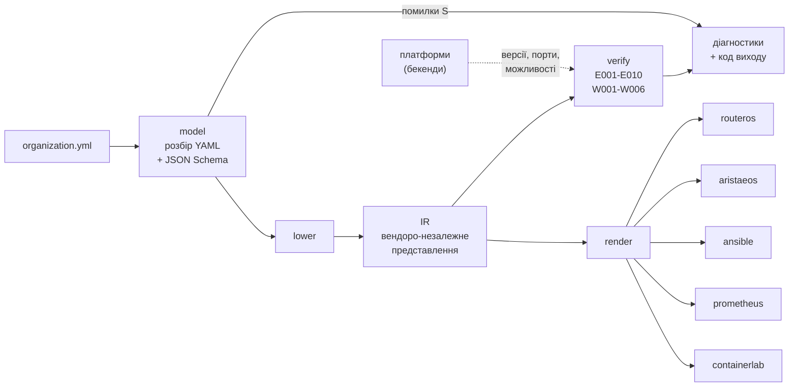
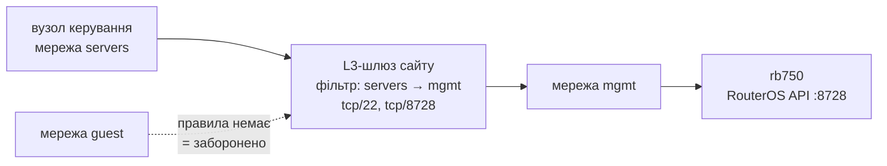

# Архітектура компілятора `orgc`

Продуктову рамку описує [CONCEPT.md](CONCEPT.md). Модель даних і повні
визначення інваріантів наведено в [data-model.md](data-model.md). Рішення, на
яких тримається архітектура, зафіксовано в ADR-005…ADR-010 (`docs/adr/`).

Компілятор написано мовою Go. Шлях модуля – `orgc` (ADR-007).

## 1. Принципи

| Принцип | Як реалізується |
|---|---|
| Перевірка до застосування | Семантичні інваріанти обчислюються над моделлю, стан обладнання компілятор не читає. Помилка виявляється на етапі компіляції |
| Ядро не знає вендорів | Перевірки працюють над проміжним представленням. Знання про платформи ізольоване в бекендах, ядро питає їх через інтерфейс |
| Нічого не застосовується | Компілятор породжує текст і завершується, без мережевих з'єднань і записів на пристрої |
| Детермінованість | Однаковий вхід дає побайтово однаковий вихід. Це предмет окремого експерименту |
| Контракт – це дані | Схема моделі описана як JSON Schema і вбудована в бінарник через `go:embed` |

## 2. Конвеєр



Модель зі структурними помилками (коди `S`) далі схеми не йде. Така модель не
має однозначного змісту, і інваріанти на ній давали б шум. `verify` і `render`
працюють над тим самим IR. `render` не запускається, якщо `verify` знайшов хоч
одну помилку. Тому згенерована конфігурація завжди походить із перевіреної
моделі.

Коди виходу `orgc verify`:

| Код | Значення |
|---|---|
| 0 | помилок немає; попередження код виходу не змінюють |
| 1 | у моделі є хоча б одна діагностика рівня «помилка», зокрема W002 рівня error |
| 2 | помилка виклику або дефект самого `orgc` |

Увесь конвеєр реалізовано: `model`, `lower`, `ir` з деревом L2, `verify` з
інваріантами E001–E010 і W001–W006, `render` і п'ять бекендів (RouterOS,
Arista EOS, Ansible, Prometheus, containerlab). Для `s-profile` команда
`orgc render` дає 11 файлів (332 рядки), а для `m-profile` 17 файлів
(701 рядок).

## 3. Компоненти

### 3.1. `model` — розбір і структурна валідація

Пакет розбирає YAML (`goccy/go-yaml`) і перевіряє його вбудованою схемою
(`santhosh-tekuri/jsonschema/v6`), ADR-006. Структурну валідацію виконує
JSON Schema: типи, формати, переліки, обов'язковість полів. Помилки валідатора
перекладаються в десять структурних кодів `S001`–`S010`. Коди згруповано за
тим, що має зробити адміністратор, і прив'язано до рядка й колонки.

`model.Load` повертає `Document`. Він містить розібрані структури, ім'я файлу
та індекс позицій «читабельний шлях → рядок:колонка»
(`sites[0].networks[2].cidr`). Індекс будується одним обходом AST і
зберігається після валідації. Тому діагностики інваріантів теж отримують рядки.

### 3.2. `lower` — пониження моделі в IR

Пакет перетворює розібраний документ на представлення, зручне для перевірок:

- посилання на сайти й мережі розв'язуються у вказівники. Посилання, яке не
  знайшлося, лишається в IR з іменем і порожнім вказівником, і про нього
  повідомляє E003;
- адреси й префікси розбираються в `netip.Addr` і `netip.Prefix`;
- для кожного сайту визначається L3-шлюз за конвенцією моделі. Це рівно один
  пристрій з роллю `edge_router` або `firewall`. Усі кандидати зберігаються
  окремо, щоб E003 розрізняв «жодного» і «кілька»;
- правила нормалізуються. `from`/`to` стають кінцями з видом (мережа, `any`,
  `internet`), типовий протокол – `tcp`, порти відсортовано. Правило без
  портів пропускає будь-який трафік.

`lower` не відмовляє через дефекти моделі, оскільки один прогін має показати
всі дефекти. Помилку він повертає лише тоді, коли схема пропустила адресу, яку
`net/netip` не розбирає. Така розбіжність означає дефект усередині самого
`orgc`.

### 3.3. `ir` — проміжне представлення

Основні сутності (ADR-008, рішення 1):

- Сайт має ім'я, `allow_overlap`, мережі, пристрої, сервери, канали, L3-шлюз і
  перелік кандидатів у шлюзи.
- Мережа має ім'я, VLAN ID, роль (`mgmt` / `users` / `servers` / `guest`),
  префікс, шлюз, DHCP-пул, ознаку ізоляції і сайт.
- Пристрій має ім'я, тип платформи, версію ОС, роль, `mgmt_ip` і сайт. Версія
  зберігається рядком, бо її формат належить платформі.
- Сервер має ім'я, ролі навантаження, адресу і сайт.
- Вузол керування містить посилання на сайт і мережу та адресу.
- Правило має кінці `from` і `to` та множину портів із протоколом.
- Зʼєднання має два кінці `пристрій:порт` і дозволені мережі. Окремо зберігаються access-порти пристроїв, порти серверів і каналів.
- Дерево L2 будується для сайту із зʼєднаннями, його корінь розташовано в L3-шлюзі. Для кожного пристрою зберігається зʼєднання до батька й множина мереж, дозволених на всьому шляху від шлюзу (бітова маска). Зʼєднання, що не дають дерева (цикл, петля на себе, друге між парою), відкладено окремо.

Елементи йдуть у порядку файлу, і кожен несе свій шлях у моделі. Сама модель
несе індекс позицій. IR не містить нічого, специфічного для конкретної
платформи. Тип пристрою є лише значенням з моделі, переліку вендорів у ядрі
немає.

### 3.4. `verify` — інваріанти

Інваріант – це чиста функція над IR і реєстром платформ, яка повертає
діагностики одного свого коду. Реєстр має фіксований порядок. Спершу йдуть
ідентифікатори й посилання, на які спирається решта. Потім ідуть адресний
план, ролі й політики, платформи, E006 і попередження. Результат сортується,
тому порядок реєстру на вивід не впливає. Реєстр передається параметром, і
тести та мутаційні експерименти підставляють власний набір перевірок.

Каскадів немає. Інваріант пропускає елемент, передумову якого вже порушено й
повідомлено іншим кодом. Наприклад, E006 не скаржиться на пристрій без
mgmt-мережі, оскільки це E004. Тоді один дефект дає рівно один код. Перевірка,
що видала діагностику з чужим кодом, означає дефект `orgc` (код виходу 2).

### 3.5. `backend` — платформи й генерація

Ядро питає платформу через інтерфейс (ADR-008, рішення 5):

| Метод | Для чого |
|---|---|
| `Type()` | значення `device.type`, яке обслуговує платформа |
| `CheckVersion(v)` | чи підтримується версія ОС; діапазон текстом для діагностики W002 |
| `ManagementPorts(v)` | транспорт, яким Ansible застосовує конфігурацію (E006) |
| `Capabilities(v)` | що вміє платформа у цій версії (W002) |

Назви можливостей не залежать від вендора й визначені в ядрі: маршрутизація
між мережами, DHCP-сервер, трансляція адрес, фільтрація зі станом, ізоляція
клієнтів. Які можливості потрібні пристрою, ядро виводить з IR. Які
можливості є, повідомляє платформа.

| Платформа | `device.type` | Версії | Порт керування |
|---|---|---|---|
| `routeros` | `mikrotik` | RouterOS 6.41–6.x | TCP 8728 (RouterOS API) |
| `aristaeos` | `arista_eos` | EOS 4.x | TCP 22 (`network_cli`) |

Реєстр платформ збирає `cmd/orgc`. Пакети `ir`, `lower`, `verify`, `render` і
сам `backend` вендорських пакетів не імпортують, і це перевіряється тестом.

Генерацію (ADR-009) поділено так само. Конфігурацію пристрою рендерить його
платформа (`Platform.Render`, `CheckPort` для імен портів). Те, що описує
модель цілком, рендерять генератори (`Generator`). Знання про платформу вони
беруть з додаткових інтерфейсів платформи:

| Бекенд | Вихід | Що генерує |
|---|---|---|
| `routeros` | `configs/<сайт>/<пристрій>.rsc` | bridge з VLAN-фільтрацією (вмикається останньою командою) і RSTP, VLAN-інтерфейси й адреси, DHCP, firewall з default deny (input і forward), NAT, ізоляція клієнтів через `horizon`; лише ASCII, для чистого пристрою |
| `aristaeos` | `configs/<сайт>/<пристрій>.cfg` | RSTP, VLAN, trunk з дозволеними VLAN, access-порти, SVI керування; на шлюзі також маршрутизація, DHCP, ACL без стану і коментарі W002 на місці відсутніх можливостей; ізоляція клієнтів через ACL на access-портах |
| `ansible` | `ansible/hosts.yml`, `ansible/group_vars/` | групи за платформою (`AnsibleTarget`), змінні підключення без секретів |
| `prometheus` | `prometheus/targets/<job>.json` | цілі `file_sd`: сервери (node_exporter), пристрої (snmp) |
| `containerlab` | `containerlab/lab.clab.yml` | вузли й образи за платформою (`LabNode`), стартові конфігурації, лінки з `links` чи конвенції; мережа керування `10.99.1.0/24` з фіксованими адресами; сервери з `port` стають вузлами Linux (ADR-010) |

Порти беруться з моделі. Для сайту без зʼєднань їх визначає конвенція
платформи. RSTP увімкнено на всіх пристроях. L3-шлюз стає коренем, а порти
резервних зʼєднань мають найбільшу вартість. Тому після збіжності STP активна
топологія збігається з деревом, яке перевіряв `verify`.
Порт керування з `ManagementPorts` завжди відкритий для мережі вузла
керування, тому згенерована конфігурація узгоджена з E006. Каталог виходу
належить `orgc` і перезаписується повністю. Файли, яких новий прогін не
генерує, зникають. Каталоги `ansible/inventories/staging/` і
`bootstrap/mon-01/prometheus/targets/` є виходом `orgc` з моделі поточного
стенда (`examples/organization.lab.yml`). Додавання нової платформи не змінює
`verify`, `lower` і генераторів.

### 3.6. `diag` — діагностики

Усі перевірки мають єдиний формат діагностики: код, рівень, повідомлення
українською, шлях до елемента моделі, рядок і колонка у вихідному YAML.

```
organization.yml:23:42: помилка S005: значення поза переліком дозволених — sites[0].networks[2].role
```

Префікси кодів не перетинаються. `S` позначає структурні дефекти, `E`
порушення інваріантів, а `W` попередження. Рівень зберігається в самій
діагностиці. Наприклад, W002 підіймається до помилки, коли версія ОС поза
діапазоном бекенда. Пакет сам сортує діагностики за файлом, рядком, колонкою,
кодом і шляхом і пише LF на будь-якій платформі.

## 4. E006 — формалізація

E006 – це головна перевірка (ADR-008, рішення 6). Для кожного пристрою `d`
позначимо:

- `N_m` – mgmt-мережа сайту `d`, що містить його `mgmt_ip` (існує за E004);
- `N_c` – мережа вузла керування;
- `P(d)` – порти керування платформи `d`, які оголошує бекенд.

E006 виконується, якщо виконано три умови:

1. `N_c = N_m` або є правило з `from ∈ {N_c, any}`, `to ∈ {N_m, any}` і
   портами, що містять порт із `P(d)` з тим самим протоколом. Правило без
   портів пропускає все.
2. Існує L3-шлях від `N_c` до `N_m`.
3. Для сайту із зʼєднаннями `N_m` дозволена на кожному зʼєднанні шляху в
   дереві L2 від шлюзу до `d`. Інакше кадри mgmt-мережі не доходять до
   пристрою. Діагностика вказує на поле `vlans` першого такого зʼєднання.

Граф топології будується так. Вершинами є мережі й L3-шлюзи сайтів. Ребра
з'єднують мережу зі шлюзом свого сайту і шлюзи всіх сайтів між собою.
Міжсайтових з'єднань модель v2 не описує, тому сайти вважаються з'єднаними
повнозв'язно незалежно від профілю. Правила політики діють як фільтр потоку на
кожному шлюзі шляху. Правила нетранзитивні: `A → B` і `B → C` не дають
`A → C`, оскільки джерело пакета на проміжному сегменті не змінюється. Тому
граф будується з топології, а правила лише фільтрують.

Алгоритм виконує один пошук у ширину від `N_c` і отримує множину досяжних
мереж. Далі для кожного пристрою перевіряється, чи належить `N_m` цій
множині, і перебираються правила. Складність становить
`O(|V| + |E| + |D|·|R|)`, де `D` – пристрої, `R` – правила.

Політики моделі v2 глобальні, тому фільтр на кожному шлюзі однаковий. Умова
зводиться до «правило дозволяє і шлях існує». Граф потрібен, щоб діагностика
називала причину порушення:

- немає правила;
- правило є, але без порту керування (діагностика наводить перелік потрібних
  портів);
- немає L3-шляху (мережа без `gateway` не маршрутизується).

Сайт без однозначного шлюзу вже дає E003, і E006 його пропускає.
Формулювання лишається правильним і тоді, коли фільтрація стане різною на
різних шлюзах.



Розглянемо приклад. Нехай правило `servers → mgmt` відкриває лише порт 22.
Модель проходить схему, але E006 спрацьовує на MikroTik. Ansible керує ним
через RouterOS API (TCP 8728), тому конфігурація з такої моделі відрізала б
його від маршрутизатора.

## 5. Детермінованість

Ця вимога породжує конкретні заборони в коді:

- жодних часових міток у згенерованих файлах, оскільки один рядок
  `# generated at ...` порушує побайтову відтворюваність;
- жоден `map` не виводиться без попереднього сортування ключів. Мапи в IR
  лише читаються за ключем, а множини можливостей бітові, з фіксованим
  порядком обходу;
- жодної випадковості, жодних ідентифікаторів, що генеруються на льоту;
- закінчення рядків LF незалежно від платформи збірки.

Діагностики сортуються в `diag`, оскільки порядок валідатора JSON Schema
залежить від обходу мапи й між прогонами різний. Тест пониження проганяє його
двадцять разів і звіряє IR. Тести `diag` перевіряють порядок на випадкових
перестановках і побайтову однаковість виводу. Вихід `render` для `s-profile` і
`m-profile` звіряється побайтово з деревами еталонів у
`testdata/golden/<модель>/`. Двадцять повторних прогонів дають однакове дерево
без жодного байта CR. Зміна одного правила моделі змінює лише конфігурацію
шлюзу свого сайту, по рядку в ланцюжках input і forward. Решти дерева вона не
зачіпає.

## 6. Модель даних

Схема `orgc/schema/organization.schema.json` описує такі сутності:

- Організація має назву, профіль масштабування `S` або `M` і перелік
  майданчиків.
- Майданчик має ім'я, мережі, пристрої, сервери, канали зв'язку (`uplinks`) і
  `allow_overlap`.
- Мережа має VLAN ID, ім'я (унікальне в усій моделі), CIDR, роль сегмента
  (`mgmt`, `users`, `servers`, `guest`), шлюз, DHCP-пул і ознаку ізоляції.
  Імена `any` і `internet` зарезервовані.
- Пристрій має ім'я, платформу (`mikrotik`, `arista_eos`), обов'язкову версію
  ОС, роль у топології і management-адресу.
- Сервер має ім'я, ролі навантаження й адресу.
- Політики задають правила міжсегментної взаємодії: джерело, призначення,
  порти, протокол. Правила лише відкривають потік (`action: allow`), діють
  stateful і нетранзитивно. Усе, чого немає в правилах, заборонено.
- Вузол керування (`control_node`) задає сайт, мережу й адресу, з яких Ansible
  застосовує конфігурації. Без цього поля E006 не має точки відліку.

`allow_overlap` дозволяє перетин адрес лише з мережами інших сайтів. Усередині
сайту перетин завжди дає E001.

Кожне поле використовується щонайменше одним інваріантом або одним бекендом.
Повний опис полів і інваріантів наведено в [data-model.md](data-model.md).

## 7. Структура коду

```text
orgc/
├── cmd/orgc/                   CLI, коди виходу, реєстр платформ
├── schema/                     organization.schema.json + go:embed
├── internal/
│   ├── model/                  розбір YAML, валідація схемою, індекс позицій
│   ├── ir/                     проміжне представлення
│   ├── lower/                  model → IR
│   ├── verify/                 реєстр і інваріанти E001-E010, W001-W006
│   ├── diag/                   діагностики: коди, рівні, сортування, формат
│   ├── render/                 збирання файлів виходу й запис дерева
│   ├── golden/                 порівняння з еталонами (для тестів)
│   └── backend/
│       ├── backend.go          інтерфейс платформи й реєстр
│       ├── render.go           File, Generator, AnsibleTarget, LabNode
│       ├── capability.go       можливості платформ
│       ├── routeros/           MikroTik RouterOS 6.x, .rsc
│       ├── aristaeos/          Arista EOS, .cfg
│       ├── ansible/            inventory + group_vars
│       ├── prometheus/         targets
│       └── containerlab/       topology
└── testdata/
    ├── valid/                  моделі, що мають проходити
    ├── broken/                 sNNN — структурні дефекти, eNNN/wNNN — інваріанти
    └── golden/                 еталонні дерева виходу render за моделями
```

Схема лежить у каталозі свого пакета, бо `go:embed` бачить лише файли в
каталозі пакета та нижче (ADR-006). Компілятор живе в репозиторії проєкту,
у теці `orgc/`, поруч із прикладами моделей і конвеєром CI.

## 8. Інтеграція з конвеєром

Пайплайн GitLab має такі стадії:

```
build      збірка образу iac-runner (Kaniko) → Registry; go version і go test у щойно зібраному образі
lint       yamllint, ansible-lint, gofmt, go vet
validate   orgc verify на прикладах моделей; go test
smoke      read-only перевірка живого RouterOS (manual, лише main)
```

Збірка образу запускається лише тоді, коли змінюється Dockerfile чи його
залежності. Решта завдань бере образ за незмінним тегом коміту, що його зібрав
(`IAC_RUNNER_IMAGE` у `.gitlab-ci.yml`). Тег `latest` не використовується,
оскільки раннер кешує образи, і `latest` у кеші міг би лишитися старим.

Завдання `orgc-verify` вимагає коду 0 для `s-profile`, `m-profile` і моделі
стенда та коду 1 для `broken` і `invariants-broken`. Код 2 (помилка виклику чи
дефект `orgc`) валить завдання. Негативна перевірка зелена лише тоді, коли
`orgc` знайшов дефекти моделі. Зламана модель валить пайплайн конкретними
кодами інваріантів.

Golden-тести всіх бекендів виконуються в `go-test`, тому будь-яка зміна
генерації без оновлення еталонів валить пайплайн. Окремої стадії `render` з
артефактами в Merge Request поки немає, вихід генерується локально.
Образ середовища виконання містить Go, засоби розгортання й лінтери із
зафіксованими версіями. Це умова відтворюваності результатів.

## 9. Тестування

| Рівень | Що перевіряє | Стан |
|---|---|---|
| Модульні | Пакети окремо; кожен інваріант має позитивний і негативний випадок | є для `model`, `lower`, `diag`, `verify`, `render`, кожного бекенда й інваріанта |
| Корпус | `testdata`: кожна модель з `broken/` дає рівно свій код і рядок; моделі `eNNN`/`wNNN` проходять схему | є |
| Golden | Побайтова відповідність усього дерева виходу `render` еталону; staging Ansible і цілі mon-01 є виходом з моделі стенда | є для `s-profile`, `m-profile` і моделі стенда |
| Мутаційні | Систематичне внесення дефектів у коректну модель; міряється частка виявлених очікуваним кодом (`experiments/e2/`) | 780 мутантів, 16 класів: виявлено 100 %, лише очікуваним кодом 100 % (до виправлення двох каскадів 98 %) |
| Наскрізні | Згенерований конфіг застосовано на живому обладнанні та в емуляторі, стан прочитано геттерами NAPALM і звірено з очікуваним станом, виведеним з моделі незалежно від `orgc` (`experiments/e4/`) | емуляція: 5 моделей, 29 пристроїв, 279 параметрів без розбіжностей, перемикання STP на трьох сайтах; живий RB750: 7 параметрів без розбіжностей, інцидент E006 відтворено (`experiments/e4/results/`) |

Негативний тест перевіряє, що спрацював очікуваний код помилки. Тест, що
перевіряв би лише факт помилки, міг би пройти з неправильної причини.

Експерименти E1–E5 (масштабування, повнота виявлення, коефіцієнт абстракції,
наскрізна валідність, локальність змін) і їхні таблиці наведено в
[experiments/README.md](../experiments/README.md).

## 10. Лабораторний стенд

| Вузол | Роль | Адреса |
|---|---|---|
| pve-a | Фізичний хост віртуалізації, Proxmox VE | 192.168.1.40 |
| ctrl-01 | Система контролю версій, CI, реєстр образів | 192.168.1.50 |
| mon-01 | Моніторинг: Prometheus, Alertmanager, Grafana, Loki | 192.168.1.51 |
| RB750 | MikroTik RouterOS 6.49.23, фізична ціль автоматизації (бекенд RouterOS приймає 6.41–6.x) | 192.168.1.220 |
| clab-01 | VM у Hyper-V на ноутбуці: Docker, containerlab, образи cEOS 4.36.2F і CHR 6.48 | 10.99.0.10 (NAT Hyper-V) |

Емуляцію виконує containerlab на `clab-01`
([ADR-010](adr/ADR-010-emulation-stand.md)). Arista cEOS стоїть на місці
комутаторів, а CHR 6.48 через vrnetlab заміщає MikroTik. Межа ємності
становить 9 cEOS і 4 CHR. Мережа керування емуляції `10.99.1.0/24`
маршрутизується до стенда через Tailscale. Так само через Tailscale ноутбук і
pve-a бачать одне одного. Гібрида з живим RB750 немає. Бекенд RouterOS
пишеться під синтаксис гілки 6.x. Обмеження цієї платформи дають природні
приклади для попередження W002.

Стенд потрібен лише для наскрізного експерименту. Компілятор збирається й
тестується локально без нього.
