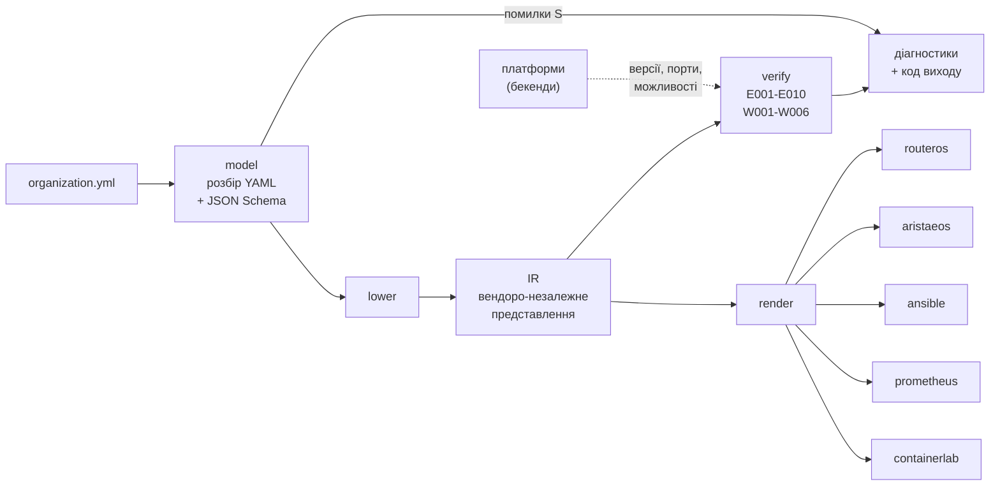
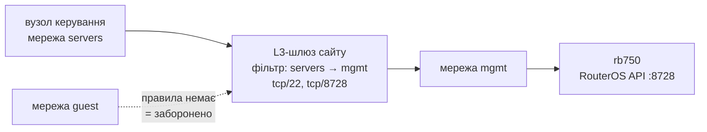

# Архітектура компілятора `orgc`

Продуктову рамку описує [CONCEPT.md](CONCEPT.md), модель даних і повні
визначення інваріантів — [data-model.md](data-model.md). Рішення, на яких
тримається архітектура, зафіксовано в ADR-005…ADR-010 (`docs/adr/`).

Мова реалізації — Go. Шлях модуля — `orgc` (ADR-007).

## 1. Принципи

| Принцип | Як реалізується |
|---|---|
| Перевірка до застосування | Семантичні інваріанти обчислюються над моделлю, стан обладнання компілятор не читає. Помилка виявляється на етапі компіляції |
| Ядро не знає вендорів | Перевірки працюють над проміжним представленням. Знання про платформи ізольоване в бекендах, ядро питає їх через інтерфейс |
| Нічого не застосовується | Компілятор породжує текст і завершується, без мережевих з'єднань і записів на пристрої |
| Детермінованість | Однаковий вхід дає побайтово однаковий вихід. Це предмет окремого експерименту |
| Контракт — це дані | Схема моделі описана як JSON Schema й вбудована в бінарник через `go:embed` |

## 2. Конвеєр



Модель зі структурними помилками (коди `S`) далі схеми не йде: вона не має
однозначного змісту, і інваріанти на ній давали б шум. `verify` і `render`
працюють над тим самим IR, і `render` не запускається, якщо `verify` знайшов
хоч одну помилку. Тому згенерована конфігурація завжди походить із перевіреної
моделі.

Коди виходу `orgc verify`:

| Код | Значення |
|---|---|
| 0 | помилок немає; попередження код виходу не змінюють |
| 1 | у моделі є хоча б одна діагностика рівня «помилка», зокрема W002 рівня error |
| 2 | помилка виклику або дефект самого `orgc` |

Стан реалізації: увесь конвеєр — `model`, `lower`, `ir` з деревом L2, `verify`
з інваріантами E001–E010 і W001–W006, `render` і п'ять бекендів (RouterOS, Arista
EOS, Ansible, Prometheus, containerlab). Для `s-profile` `orgc render` дає 11
файлів (332 рядки), для `m-profile` — 17 (701 рядок).

## 3. Компоненти

### 3.1. `model` — розбір і структурна валідація

Розбирає YAML (`goccy/go-yaml`) і перевіряє його вбудованою схемою
(`santhosh-tekuri/jsonschema/v6`), ADR-006. Структурна валідація лишається за
JSON Schema: типи, формати, переліки, обов'язковість полів. Помилки валідатора
перекладаються в десять структурних кодів `S001`–`S010`, згрупованих за тим,
що має зробити адміністратор, і прив'язуються до рядка й колонки.

`model.Load` повертає `Document`: розібрані структури, ім'я файлу та індекс
позицій «читабельний шлях → рядок:колонка» (`sites[0].networks[2].cidr`).
Індекс будується одним обходом AST і переживає валідацію, тож діагностики
інваріантів теж отримують рядки.

### 3.2. `lower` — пониження моделі в IR

Перетворює розібраний документ на представлення, зручне для перевірок:

- посилання на сайти й мережі розв'язуються у вказівники; посилання, яке не
  знайшлося, лишається в IR з іменем і порожнім вказівником, і про нього
  повідомляє E003;
- адреси й префікси розбираються в `netip.Addr` і `netip.Prefix`;
- для кожного сайту визначається L3-шлюз за конвенцією моделі: рівно один
  пристрій з роллю `edge_router` або `firewall`; усі кандидати зберігаються
  окремо, щоб E003 розрізняв «жодного» і «кілька»;
- правила нормалізуються: `from`/`to` стають кінцями з видом (мережа, `any`,
  `internet`), протокол за замовчуванням — `tcp`, порти відсортовано, правило
  без портів пропускає будь-який трафік.

`lower` не відмовляє через дефекти моделі: один прогін має показати всі
дефекти. Помилку він повертає лише тоді, коли схема пропустила адресу, яку
`net/netip` не розбирає, бо це розбіжність усередині самого `orgc`.

### 3.3. `ir` — проміжне представлення

Основні сутності (ADR-008, рішення 1):

- Сайт — ім'я, `allow_overlap`, мережі, пристрої, сервери, канали, L3-шлюз і
  перелік кандидатів у шлюзи.
- Мережа — ім'я, VLAN ID, роль (`mgmt` / `users` / `servers` / `guest`),
  префікс, шлюз, DHCP-пул, ознака ізоляції, сайт.
- Пристрій — ім'я, тип платформи, версія ОС (рядком: формат версії належить
  платформі), роль, `mgmt_ip`, сайт.
- Сервер — ім'я, ролі навантаження, адреса, сайт.
- Вузол керування — посилання на сайт і мережу, адреса.
- Правило — кінці `from` і `to`, множина портів із протоколом.
- Зʼєднання — два кінці `пристрій:порт` і дозволені мережі; access-порти пристроїв, порти серверів і каналів.
- Дерево L2 сайту із зʼєднаннями — корінь у L3-шлюзі, для кожного пристрою зʼєднання до батька й множина мереж, дозволених на всьому шляху від шлюзу (бітова маска). Зʼєднання, що не дають дерева (цикл, петля на себе, друге між парою), відкладено окремо.

Елементи йдуть у порядку файлу, кожен несе шлях у моделі, а модель — індекс
позицій. IR не містить нічого, специфічного для конкретної платформи: тип
пристрою — лише значення з моделі, без переліку вендорів у ядрі.

### 3.4. `verify` — інваріанти

Інваріант — чиста функція над IR і реєстром платформ, що повертає діагностики
одного свого коду. Реєстр має фіксований порядок: спершу ідентифікатори й
посилання, на які спирається решта, потім адресний план, ролі й політики,
платформи, E006 і попередження. Результат сортується, тож порядок реєстру на
вивід не впливає. Реєстр передається параметром: тести й мутаційні
експерименти підставляють власний набір перевірок.

Каскадів немає: інваріант пропускає елемент, передумову якого вже порушено й
повідомлено іншим кодом (наприклад, E006 не скаржиться на пристрій без
mgmt-мережі, бо це E004). Тоді один дефект дає рівно один код. Перевірка, що
видала діагностику з чужим кодом, — дефект `orgc` (код виходу 2).

### 3.5. `backend` — платформи й генерація

Ядро питає платформу через інтерфейс (ADR-008, рішення 5):

| Метод | Для чого |
|---|---|
| `Type()` | значення `device.type`, яке обслуговує платформа |
| `CheckVersion(v)` | чи підтримується версія ОС; діапазон текстом для діагностики W002 |
| `ManagementPorts(v)` | транспорт, яким Ansible застосовує конфігурацію (E006) |
| `Capabilities(v)` | що вміє платформа у цій версії (W002) |

Назви можливостей нейтральні до вендора й визначені в ядрі: маршрутизація між
мережами, DHCP-сервер, трансляція адрес, фільтрація зі станом, ізоляція
клієнтів. Що потрібно пристрою, ядро виводить з IR; що є, каже платформа.

| Платформа | `device.type` | Версії | Порт керування |
|---|---|---|---|
| `routeros` | `mikrotik` | RouterOS 6.41–6.x | TCP 8728 (RouterOS API) |
| `aristaeos` | `arista_eos` | EOS 4.x | TCP 22 (`network_cli`) |

Реєстр платформ збирає `cmd/orgc`; пакети `ir`, `lower`, `verify`, `render` і
сам `backend` вендорських пакетів не імпортують, і це перевіряється тестом.

Генерація (ADR-009) ділиться так само. Конфігурацію пристрою рендерить його
платформа (`Platform.Render`, `CheckPort` для імен портів); те, що описує модель
цілком, рендерять генератори (`Generator`), які знання про платформу беруть з
додаткових інтерфейсів платформи:

| Бекенд | Вихід | Що генерує |
|---|---|---|
| `routeros` | `configs/<сайт>/<пристрій>.rsc` | bridge з VLAN-фільтрацією (вмикається останньою командою) і RSTP, VLAN-інтерфейси й адреси, DHCP, firewall з default deny (input і forward), NAT, ізоляція клієнтів через `horizon`; лише ASCII, для чистого пристрою |
| `aristaeos` | `configs/<сайт>/<пристрій>.cfg` | RSTP, VLAN, trunk з дозволеними VLAN, access-порти, SVI керування; на шлюзі — маршрутизація, DHCP, ACL без стану, коментарі W002 на місці відсутніх можливостей; ізоляція клієнтів — ACL на access-портах |
| `ansible` | `ansible/hosts.yml`, `ansible/group_vars/` | групи за платформою (`AnsibleTarget`), змінні підключення без секретів |
| `prometheus` | `prometheus/targets/<job>.json` | цілі `file_sd`: сервери (node_exporter), пристрої (snmp) |
| `containerlab` | `containerlab/lab.clab.yml` | вузли й образи за платформою (`LabNode`), стартові конфігурації, лінки з `links` чи конвенції; мережа керування `10.99.1.0/24` з фіксованими адресами; сервери з `port` — вузли Linux (ADR-010) |

Порти беруться з моделі, для сайту без зʼєднань — з конвенції платформи.
RSTP увімкнено на всіх пристроях: L3-шлюз — корінь, порти резервних зʼєднань
мають найбільшу вартість, тож після збіжності STP активна топологія — те саме
дерево, яке перевіряв `verify`.
Порт керування з `ManagementPorts` завжди відкритий для мережі вузла
керування, тож згенерована конфігурація узгоджена з E006. Каталог виходу
належить `orgc` і перезаписується повністю: файли, яких новий прогін не
генерує, зникають. `ansible/inventories/staging/` і
`bootstrap/mon-01/prometheus/targets/` — вихід `orgc` з моделі поточного стенда
(`examples/organization.lab.yml`). Додавання нової платформи не змінює
`verify`, `lower` і генераторів.

### 3.6. `diag` — діагностики

Єдиний формат для всіх перевірок: код, рівень, повідомлення українською, шлях
до елемента моделі, рядок і колонка у вихідному YAML.

```
organization.yml:23:42: помилка S005: значення поза переліком дозволених — sites[0].networks[2].role
```

Префікси кодів не перетинаються: `S` — структурні дефекти, `E` — порушення
інваріантів, `W` — попередження. Рівень зберігається в самій діагностиці: W002
підіймається до помилки, коли версія ОС поза діапазоном бекенда. Пакет сам
сортує діагностики за файлом, рядком, колонкою, кодом і шляхом і пише LF на
будь-якій платформі.

## 4. E006 — формалізація

Головна перевірка (ADR-008, рішення 6). Для кожного пристрою `d`:

- `N_m` — mgmt-мережа сайту `d`, що містить його `mgmt_ip` (існує за E004);
- `N_c` — мережа вузла керування;
- `P(d)` — порти керування платформи `d`, які оголошує бекенд.

E006 виконується, якщо (1) `N_c = N_m` або є правило з `from ∈ {N_c, any}`,
`to ∈ {N_m, any}` і портами, що містять порт із `P(d)` з тим самим протоколом
(правило без портів пропускає все); (2) існує L3-шлях від `N_c` до `N_m`; і (3) для
сайту із зʼєднаннями `N_m` дозволена на кожному зʼєднанні шляху в дереві L2 від
шлюзу до `d` — інакше кадри mgmt-мережі не доходять до пристрою (діагностика
вказує на поле `vlans` першого такого зʼєднання).

Граф топології: вершини — мережі й L3-шлюзи сайтів; ребра — мережа ↔ шлюз
свого сайту і шлюз ↔ шлюз між усіма сайтами. Міжсайтових з'єднань модель v2 не
описує, тому сайти вважаються з'єднаними повнозв'язно незалежно від профілю.
Правила політики діють як фільтр потоку на кожному шлюзі шляху. Правила
нетранзитивні: `A → B` і `B → C` не дають `A → C`, бо джерело пакета на
проміжному сегменті не змінюється. Тому граф будується з топології, а правила
лише фільтрують.

Алгоритм: один пошук у ширину від `N_c` дає множину досяжних мереж, далі для
кожного пристрою перевіряється належність `N_m` цій множині й перебираються
правила. Складність — `O(|V| + |E| + |D|·|R|)`, де `D` — пристрої, `R` —
правила.

Політики моделі v2 глобальні, тож фільтр на кожному шлюзі однаковий, і умова
зводиться до «правило дозволяє і шлях існує». Граф потрібен, щоб діагностика
називала причину: немає правила; правило є, але без порту керування (з
переліком потрібних портів); немає L3-шляху (мережа без `gateway` не
маршрутизується). Сайт без однозначного шлюзу вже дає E003, і E006 його
пропускає.
Формулювання лишається правильним і тоді, коли фільтрація стане різною на
різних шлюзах.



Демонстраційний випадок: якщо правило `servers → mgmt` відкриває лише порт 22,
модель проходить схему, але E006 спрацьовує на MikroTik. Ansible керує ним
через RouterOS API (TCP 8728), і конфігурація з такої моделі відрізала б його
від маршрутизатора.

## 5. Детермінованість

Вимога породжує конкретні заборони в коді:

- жодних часових міток у згенерованих файлах: один рядок
  `# generated at ...` порушує побайтову відтворюваність;
- жоден `map` не виводиться без попереднього сортування ключів; мапи в IR
  лише читаються за ключем, множини можливостей — бітові, з фіксованим
  порядком обходу;
- жодної випадковості, жодних ідентифікаторів, що генеруються на льоту;
- закінчення рядків — LF, незалежно від платформи збірки.

Діагностики сортуються в `diag`: порядок валідатора JSON Schema залежить від
обходу мапи й між прогонами різний. Тест пониження проганяє його двадцять
разів і звіряє IR, тести `diag` — порядок на випадкових перестановках і
побайтову однаковість виводу. Вихід `render` для `s-profile` і `m-profile`
звіряється побайтово з деревами еталонів у `testdata/golden/<модель>/`;
двадцять повторних прогонів дають те саме дерево, без жодного байта CR.
Зміна одного правила моделі змінює лише конфігурацію шлюзу свого сайту — по
рядку в ланцюжках input і forward, — а решту дерева не зачіпає.

## 6. Модель даних

Схема `orgc/schema/organization.schema.json` описує:

Організація — назва, профіль масштабування `S` або `M`, перелік майданчиків.

Майданчик — ім'я, мережі, пристрої, сервери, канали зв'язку (`uplinks`),
`allow_overlap`.

Мережа — VLAN ID, ім'я (унікальне в усій моделі), CIDR, роль сегмента (`mgmt`,
`users`, `servers`, `guest`), шлюз, DHCP-пул, ознака ізоляції. Імена `any` і
`internet` зарезервовані.

Пристрій — ім'я, платформа (`mikrotik`, `arista_eos`), обов'язкова версія ОС,
роль у топології, management-адреса.

Сервер — ім'я, ролі навантаження, адреса.

Політики — правила міжсегментної взаємодії: джерело, призначення, порти,
протокол. Правила лише відкривають потік (`action: allow`), діють stateful і
нетранзитивно; усе, чого немає в правилах, заборонено.

Вузол керування (`control_node`) — сайт, мережа й адреса, з яких Ansible
застосовує конфігурації. Без цього поля E006 не має точки відліку.

`allow_overlap` дозволяє перетин адрес лише з мережами інших сайтів; усередині
сайту перетин завжди дає E001.

Кожне поле використовується щонайменше одним інваріантом або одним бекендом.
Повний опис полів і інваріантів — [data-model.md](data-model.md).

## 7. Структура коду

```text
orgc/
├── cmd/orgc/                   CLI, коди виходу, реєстр платформ
├── schema/                     organization.schema.json + go:embed
├── internal/
│   ├── model/                  розбір YAML, валідація схемою, індекс позицій
│   ├── ir/                     проміжне представлення
│   ├── lower/                  model → IR
│   ├── verify/                 реєстр і інваріанти E001-E010, W001-W006
│   ├── diag/                   діагностики: коди, рівні, сортування, формат
│   ├── render/                 збирання файлів виходу й запис дерева
│   ├── golden/                 порівняння з еталонами (для тестів)
│   └── backend/
│       ├── backend.go          інтерфейс платформи й реєстр
│       ├── render.go           File, Generator, AnsibleTarget, LabNode
│       ├── capability.go       можливості платформ
│       ├── routeros/           MikroTik RouterOS 6.x, .rsc
│       ├── aristaeos/          Arista EOS, .cfg
│       ├── ansible/            inventory + group_vars
│       ├── prometheus/         targets
│       └── containerlab/       topology
└── testdata/
    ├── valid/                  моделі, що мають проходити
    ├── broken/                 sNNN — структурні дефекти, eNNN/wNNN — інваріанти
    └── golden/                 еталонні дерева виходу render за моделями
```

Схема лежить у каталозі свого пакета, бо `go:embed` бачить лише файли в
каталозі пакета та нижче (ADR-006). Компілятор живе в репозиторії проєкту,
у теці `orgc/`, поруч із прикладами моделей і конвеєром CI.

## 8. Інтеграція з конвеєром

Пайплайн GitLab має стадії:

```
build      збірка образу iac-runner (Kaniko) → Registry; go version і go test у щойно зібраному образі
lint       yamllint, ansible-lint, gofmt, go vet
validate   orgc verify на прикладах моделей; go test
smoke      read-only перевірка живого RouterOS (manual, лише main)
```

Збірка образу запускається лише тоді, коли змінюється Dockerfile чи його
залежності. Решта завдань бере образ за незмінним тегом коміту, що його зібрав
(`IAC_RUNNER_IMAGE` у `.gitlab-ci.yml`), а не `latest`: раннер кешує образи, і
`latest` у кеші міг би лишитися старим.

`orgc-verify` вимагає коду 0 для `s-profile`, `m-profile` і моделі стенда та
саме коду 1 для `broken` і `invariants-broken`. Код 2 (помилка виклику чи
дефект `orgc`) завдання валить: негативна перевірка зелена лише тоді, коли
`orgc` знайшов дефекти моделі. Зламана модель валить пайплайн конкретними
кодами інваріантів, а не загальною помилкою розбору.

Golden-тести всіх бекендів виконуються в `go-test`, тож будь-яка зміна
генерації без оновлення еталонів валить пайплайн. Окремої стадії `render` з
артефактами в Merge Request поки немає: вихід генерується локально.
Образ середовища виконання містить Go, засоби розгортання й лінтери із
зафіксованими версіями: це умова відтворюваності результатів.

## 9. Тестування

| Рівень | Що перевіряє | Стан |
|---|---|---|
| Модульні | Пакети окремо; кожен інваріант — позитивний і негативний випадок | є для `model`, `lower`, `diag`, `verify`, `render`, кожного бекенда й інваріанта |
| Корпус | `testdata`: кожна модель з `broken/` дає рівно свій код і рядок; моделі `eNNN`/`wNNN` проходять схему | є |
| Golden | Побайтова відповідність усього дерева виходу `render` еталону; staging Ansible і цілі mon-01 — вихід з моделі стенда | є для `s-profile`, `m-profile` і моделі стенда |
| Мутаційні | Систематичне внесення дефектів у коректну модель; міряється частка виявлених | заплановано |
| Наскрізні | Згенерований конфіг застосовано на живому обладнанні та в емуляторі, стан прочитано геттерами NAPALM і звірено з очікуваним станом, виведеним з моделі незалежно від `orgc` (`experiments/e4/`) | емуляція: 5 моделей, 29 пристроїв, 273 параметри без розбіжностей, перемикання STP на трьох сайтах; живий RB750: 7 параметрів без розбіжностей, інцидент E006 відтворено (`experiments/e4/results/`) |

Правило для негативних тестів: перевіряється, що спрацював саме той код
помилки, а не будь-яка помилка. Інакше тест проходить із неправильної причини.

## 10. Лабораторний стенд

| Вузол | Роль | Адреса |
|---|---|---|
| pve-a | Фізичний хост віртуалізації, Proxmox VE | 192.168.1.40 |
| ctrl-01 | Система контролю версій, CI, реєстр образів | 192.168.1.50 |
| mon-01 | Моніторинг: Prometheus, Alertmanager, Grafana, Loki | 192.168.1.51 |
| RB750 | MikroTik RouterOS 6.48 — фізична ціль автоматизації | 192.168.1.220 |
| clab-01 | VM у Hyper-V на ноутбуці: Docker, containerlab, образи cEOS 4.36.2F і CHR 6.48 | 10.99.0.10 (NAT Hyper-V) |

Емуляція — containerlab на `clab-01` ([ADR-010](adr/ADR-010-emulation-stand.md)): Arista cEOS
на місці комутаторів, CHR 6.48 через vrnetlab на місці MikroTik. Межа
ємності — 9 cEOS і 4 CHR. Мережа керування емуляції `10.99.1.0/24`
маршрутизується до стенда через Tailscale; ноутбук і pve-a бачать одне
одного так само. Гібрида з живим RB750 немає. Бекенд RouterOS пишеться під
синтаксис гілки 6.x; обмеження цієї платформи дають природні приклади для
попередження W002.

Стенд потрібен лише для наскрізного експерименту. Компілятор збирається й
тестується локально без нього.
