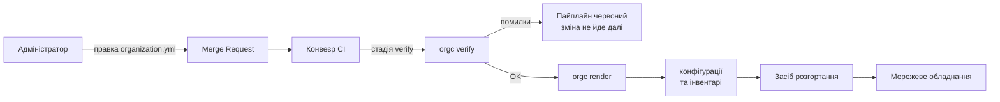

# Концепція: компілятор організації `orgc`

Технічну реалізацію описує [ARCHITECTURE.md](ARCHITECTURE.md).

## 1. Проблема

Засоби інфраструктури як коду (Ansible, Terraform, вендорні системи керування)
оперують описом стану окремих пристроїв. Адміністратор задає конфігурацію
кожного вузла й тримає узгодженість між ними у власній голові: чи не перетнулись
адресні простори, чи унікальні ідентифікатори сегментів, чи не заблокує нове
правило доступ до самого пристрою.

Структурні валідатори цю прогалину не закривають. JSON Schema, лінтери й
перевірки синтаксису контролюють форму документа, але принципово не бачать
зв'язків між сутностями. Схема підтвердить, що адреса записана правильно; вона
не скаже, що дві мережі перекриваються, що правило доступу посилається на
неіснуючий сегмент або що після застосування конфігурації пристрій стане
недосяжним.

Наслідок — клас відмов, які виявляються вже на живому обладнанні. Найгостріший
випадок: конфігурація синтаксично бездоганна, застосована успішно, але після неї
адміністратор більше не має доступу до пристрою. Типова причина — правила
фільтрації, які закривають управління з того сегмента, звідки ним керують.
Відновлення вимагає фізичного доступу до обладнання.

Ansible виконує записані завдання, Terraform будує граф ресурсів. Жоден із них
не перевіряє, чи лишиться після цього шлях до пристрою.

## 2. Ідея

Адміністратор описує організацію: майданчики, мережеві сегменти з ролями,
пристрої, політики взаємодії між сегментами. Конфігурацій пристроїв він не пише.

Коректність цього опису перевіряється формально й до застосування. Далі з
того самого опису механічно породжуються конфігурації різнорідного обладнання.

```
опис організації → перевірка інваріантів → конфігурації пристроїв
```

Автоматизація вже існує. Від класичного підходу метод відрізняється моментом
виявлення помилки: дефект семантики знаходиться на етапі компіляції, до
експлуатації.

## 3. Програмне рішення

Компілятор `orgc`. Дві команди:

```
orgc verify organization.yml    діагностики або OK; ненульовий код виходу при помилках
orgc render organization.yml    конфігурації пристроїв та інвентарі
```

Компілятор нічого не застосовує: він породжує текст і завершується.
Застосування виконує окремий ланцюг розгортання. Таке обмеження розділяє
відповідальність і робить компілятор безпечним для запуску будь-де,
зокрема на робочій станції без доступу до мережі керування.

Вхід — `organization.yml`. Вихід — конфігурації MikroTik RouterOS, конфігурації
Arista EOS, інвентар Ansible з груповими змінними, цілі моніторингу, топологія
для мережевого емулятора.

## 4. Інваріанти

Перевірки виконуються над вендоро-незалежним проміжним представленням моделі,
текст конфігурацій вони не аналізують.

| Код | Перевірка |
|---|---|
| E001 | Неперетин CIDR у межах моделі; між сайтами — лише з `allow_overlap` |
| E002 | Унікальність ідентифікаторів: VLAN ID у сайті; сайти, мережі, пристрої й сервери — у моделі |
| E003 | Цілісність посилань: політика → мережа, `control_node` → сайт і мережа, мережа з `gateway` → L3-шлюз сайту |
| E004 | `mgmt_ip` належить мережі з роллю mgmt того самого сайту |
| E005 | Збереження default-deny: немає правил `any → any` і `from: internet` |
| E006 | Досяжність керування |
| E007 | Узгодженість адресного плану: шлюз і статичні адреси в мережі й поза DHCP-пулом, без колізій |
| E008 | Достатність ємності префікса |
| E009 | L2-звʼязність сайту із зʼєднаннями: шлях кожного пристрою до шлюзу, доставка VLAN до access-портів |
| E010 | Топологія сайту із зʼєднаннями: активні зʼєднання — дерево з коренем у L3-шлюзі, кожне резервне замикає з ним рівно один цикл |
| W001 | Guest-мережа без ізоляції або з доступом не лише до `internet` |
| W002 | Можливість не підтримується цільовою платформою; версія ОС поза діапазоном бекенда — рівень помилки |
| W003 | Сайт профілю M без резервного каналу |
| W004 | mgmt-сегмент відкрито не лише для мережі вузла керування |
| W005 | Ієрархія ролей: рівень core → distribution → access зростає від шлюзу |
| W006 | Керованість при відмові зʼєднання: резервний шлях пропускає mgmt-мережу |

Повні визначення — у [data-model.md](data-model.md).

E006 — головна перевірка. Вона стверджує: для кожного пристрою потік від
мережі вузла керування до mgmt-мережі пристрою на порт керування його
платформи дозволено політикою і має L3-шлях через шлюзи сайтів. Якщо це не
так, застосування конфігурації відріже засіб розгортання від обладнання.
Наприклад, MikroTik керується через RouterOS API (TCP 8728), і правило, що
відкриває керування лише по SSH, синтаксично коректне, але E006 порушує.

E006 і W004 описують дві протилежні властивості мережі керування: вона
досяжна для вузла керування і не відкрита зайвим мережам.

Наявні засоби цей клас відмов не виявляють у принципі, і причина не в
недосконалості реалізації: у них немає моделі організації, у якій таке питання
можна поставити. Ansible бачить список завдань для хоста, Terraform — граф
ресурсів; жоден не знає, що таке «шлях від адміністратора до пристрою».

Новизна методу полягає в шарі формальної перевірки між описом і генерацією:
він перевіряє властивості, які досі перевіряла людина. Генерація конфігурацій
сама по собі новою не є.

## 5. Межі

Межі `orgc` визначено проєктним рішенням, це не прогалини:

- не застосовує конфігурації, тільки породжує текст;
- не читає стан обладнання, працює виключно з моделлю;
- не виконує безперервного узгодження стану (питання винесене в розділ
  перспектив);
- не керує секретами: паролі й токени лишаються поза моделлю;
- не замінює засоби розгортання, а готує для них вхідні дані.

## 6. Профілі масштабування

Модель описує два профілі:

| | S | M |
|---|---|---|
| Топологія | один майданчик | кілька майданчиків |
| Зв'язок між сайтами | — | модель не описує; для E006 сайти вважаються з'єднаними повнозв'язно |
| Резервний канал | не вимагається | очікується, інакше W003 |

Профіль впливає на перевірки лише через W003. Розширення на більші масштаби
можливе, але лежить поза межами роботи.

## 7. Безпека як інваріант

Безпека реалізована без окремого функціонального блоку, як наскрізна
властивість, яку гарантує сам компілятор:

- сегментація описана в моделі явно, через ролі сегментів;
- default-deny між сегментами перевіряється (E005) і не тримається на
  домовленості між людьми;
- management-доступ обмежений mgmt-сегментом (E004, W004) і при цьому
  доведено досяжний (E006);
- ізоляція guest-сегмента перевіряється (W001);
- кожна зміна проходить через рецензований запит на злиття з diff та
  аудитом у системі контролю версій.

Зазвичай ці властивості декларуються в документації й тримаються дисципліною.
Тут вони формулюються як предикати над моделлю й перевіряються машинно.

## 8. Місце в процесі розгортання



Компілятор вбудовується в конвеєр як окрема стадія перед розгортанням. Решта
ланцюга не змінюється: метод доповнює чинний процес і не вимагає його заміни.

## 9. Критерії успіху

Робота вважається виконаною, якщо:

1. Компілятор реалізує всі десять інваріантів і п'ять попереджень, кожне з
   позитивним і негативним тестом.
2. `orgc render` породжує конфігурації щонайменше для двох різних платформ, і
   вихід побайтово детермінований.
3. Згенеровану конфігурацію застосовано на живому обладнанні, а фактичний стан
   прочитано й звірено з очікуваним.
4. Виміряно повноту виявлення дефектів методом мутаційного тестування.
5. Показано, що E006 виявляє відмови, які наявні засоби пропускають.

Пункт 5 — визначальний.
