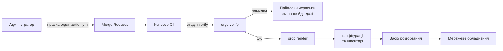

# Концепція: компілятор організації `orgc`

Технічну реалізацію описує [ARCHITECTURE.md](ARCHITECTURE.md).

---

## 1. Проблема

Засоби інфраструктури як коду — Ansible, Terraform, вендорні системи керування —
оперують описом стану **окремих пристроїв**. Адміністратор задає конфігурацію
кожного вузла й тримає узгодженість між ними у власній голові: чи не перетнулись
адресні простори, чи унікальні ідентифікатори сегментів, чи не заблокує нове
правило доступ до самого пристрою.

Структурні валідатори цю прогалину не закривають. JSON Schema, лінтери й
перевірки синтаксису контролюють **форму** документа, але принципово не бачать
зв'язків між сутностями. Схема підтвердить, що адреса записана правильно; вона
не скаже, що дві мережі перекриваються, що правило доступу посилається на
неіснуючий сегмент або що після застосування конфігурації пристрій стане
недосяжним.

Наслідок — клас відмов, які виявляються вже на живому обладнанні. Найгостріший
випадок: конфігурація синтаксично бездоганна, застосована успішно, але після неї
адміністратор більше не має доступу до пристрою. Типова причина — правила
фільтрації, які закривають управління з того сегмента, звідки ним керують.
Відновлення вимагає фізичного доступу до обладнання.

Ansible виконає те, що написано. Terraform побудує граф ресурсів. Жоден із них
не спитає, чи лишиться після цього шлях до пристрою.

## 2. Ідея

Адміністратор описує **організацію**, а не конфігурацію пристроїв: майданчики,
мережеві сегменти з ролями, пристрої, політики взаємодії між сегментами.

Коректність цього опису перевіряється **формально й до застосування**. Далі з
того самого опису механічно породжуються конфігурації різнорідного обладнання.

```
опис організації → перевірка інваріантів → конфігурації пристроїв
```

Ключове зміщення проти класичного підходу — не в автоматизації, вона вже
існує, а в **моменті виявлення помилки**. Дефект семантики знаходиться на етапі
компіляції, а не на етапі експлуатації.

## 3. Програмне рішення

Компілятор `orgc`. Дві команди:

```
orgc verify organization.yml    діагностики або OK; ненульовий код виходу при помилках
orgc render organization.yml    конфігурації пристроїв та інвентарі
```

**Компілятор нічого не застосовує.** Він породжує текст і завершується.
Застосування виконує окремий ланцюг розгортання. Це свідоме обмеження: воно
розділяє відповідальність і робить компілятор безпечним для запуску будь-де,
зокрема на робочій станції без доступу до мережі керування.

Вхід — `organization.yml`. Вихід — конфігурації MikroTik RouterOS, конфігурації
Arista EOS, інвентар Ansible з груповими змінними, цілі моніторингу, топологія
для мережевого емулятора.

## 4. Наукове ядро: інваріанти

Перевірки виконуються не над текстом конфігурації, а над вендоро-незалежним
проміжним представленням моделі.

| Код | Перевірка |
|---|---|
| E001 | Неперетин CIDR у межах сайту |
| E002 | Унікальність VLAN ID |
| E003 | Цілісність посилань: політика → мережа, пристрій → сайт |
| E004 | `mgmt_ip` належить мережі з роллю mgmt |
| E005 | Замкненість default-deny, відсутність правил any→any allow |
| E006 | **Досяжність управління** |
| E007 | Узгодженість адресного плану: шлюз поза DHCP-пулом тощо |
| E008 | Достатність ємності префікса |
| W001 | Guest-мережа без ізоляції |
| W002 | Можливість не підтримується цільовою платформою |
| W003 | Сайт профілю M без резервного каналу |

**E006 — головна перевірка роботи.** Вона стверджує: для кожного пристрою існує
дозволений політиками шлях від вузла керування до мережі, якій належить
`mgmt_ip` цього пристрою. Якщо такого шляху немає, застосування конфігурації
відріже адміністратора від обладнання.

Цей клас відмов наявні засоби не виявляють **у принципі** — не через
недосконалість реалізації, а тому що вони не мають моделі організації, у якій
таке питання можна поставити. Ansible бачить список завдань для хоста,
Terraform — граф ресурсів; ані той, ані інший не знає, що таке «шлях від
адміністратора до пристрою».

Саме тут лежить новизна: не в генерації конфігурацій, а в тому, що між описом і
генерацією стоїть шар формальної перевірки властивостей, які досі перевіряла
людина.

## 5. Межі

`orgc` **не робить** наступного, і це рішення, а не прогалини:

- **не застосовує конфігурації** — тільки породжує текст;
- **не читає стан обладнання** — працює виключно з моделлю;
- **не виконує безперервного узгодження** стану — питання винесене в розділ
  перспектив;
- **не керує секретами** — паролі й токени лишаються поза моделлю;
- **не замінює засоби розгортання** — він готує для них вхідні дані.

## 6. Профілі масштабування

Модель описує два профілі:

| | **S** | **M** |
|---|---|---|
| Топологія | один майданчик | кілька майданчиків |
| Зв'язок між сайтами | — | тунель |
| Резервний канал | не вимагається | очікується, інакше W003 |

Профіль визначає, які перевірки застосовні. Розширення на більші масштаби
можливе, але лежить поза межами роботи.

## 7. Безпека як інваріант, а не як модуль

Безпека в цій роботі — не окремий функціональний блок, а наскрізна властивість,
яку гарантує сам компілятор:

- **сегментація** описана в моделі явно, через ролі сегментів;
- **default-deny** між сегментами — властивість, що перевіряється (E005), а не
  домовленість між людьми;
- **management-доступ** обмежений mgmt-сегментом (E004) і при цьому доведено
  досяжний (E006);
- **ізоляція guest-сегмента** перевіряється (W001);
- **кожна зміна** проходить через рецензований запит на злиття з diff та
  аудитом у системі контролю версій.

Різниця принципова: зазвичай ці властивості декларуються в документації й
тримаються дисципліною, тут вони формулюються як предикати над моделлю й
перевіряються машинно.

## 8. Місце в процесі розгортання



Компілятор вбудовується в конвеєр як окрема стадія перед розгортанням. Решта
ланцюга не змінюється — у цьому й полягає прикладна цінність: метод
доповнює чинний процес, а не вимагає його заміни.

## 9. Критерії успіху

Робота вважається виконаною, якщо:

1. Компілятор реалізує всі вісім інваріантів і три попередження, кожне з
   позитивним і негативним тестом.
2. `orgc render` породжує конфігурації щонайменше для двох різних платформ, і
   вихід побайтово детермінований.
3. Згенеровану конфігурацію застосовано на живому обладнанні, а фактичний стан
   прочитано й звірено з очікуваним.
4. Виміряно повноту виявлення дефектів методом мутаційного тестування.
5. Показано, що E006 виявляє відмови, які наявні засоби пропускають.

Пункт 5 — визначальний. Без нього робота лишається інженерною.
