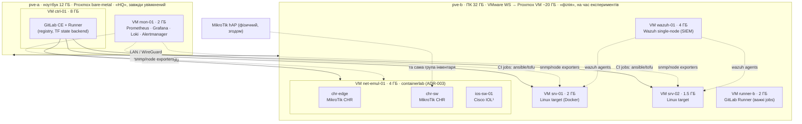

> Документ попередньої версії проєкту (до 09.2026), не відображає поточну архітектуру.

# M0 — Лабораторний стенд

> Статус: **в роботі — pve-a (HQ) готовий, мінімальний DoD досягнуто 2026-06-10** (див. §5). pve-b та мережа — наступні мілстоуни.
> Мета: на двох вузлах (ноут 12 ГБ bare-metal + ПК 32 ГБ nested, ADR-001 rev.2) отримати стенд, що відтворює multi-site інфраструктуру: постійний control plane («HQ») + експериментальний «сайт-філія».

## 1. Топологія стенда

¹ якщо закриємо питання легальних образів (ADR-003); інакше Cisco — лише фізично.

## 2. Бюджет RAM (оновлено 2026-06-11 після апгрейду)

**pve-a (ноутбук, 8→16 ГБ після +8 ГБ):** Proxmox host ~1 · ctrl-01 (GitLab CE tuned + runner) 8 · mon-01 2 → **~11, резерв ~5** (диск 128 ГБ — стежити за registry). На час 8 ГБ ctrl-01 тримали на 6 ГБ без mon-01 (див. M0-report §відхилення); після апгрейду ctrl-01 повертається на 8 ГБ і додається mon-01.

**pve-b (ПК 32 ГБ, +1 ТБ SSD → 1.5 ТБ сховища):** VM ~20 ГБ під Proxmox, у Windows лишається ~10. net-emul-01 4 · wazuh-01 4 · srv-01/02 3.5 · runner-b 2 · Proxmox host 1 → **~14.5, резерв ~5**. Диск більше не лімітує: образи VM, снапшоти «до/після», ISO, registry-кеш — на швидкому 1 ТБ SSD.

Висновок: повний стек (GitLab CE + Wazuh) розкладається на два вузли з запасом; multi-site (S→M) демонструється на двох *реальних* вузлах через WireGuard. Питання «чи тягне ноут GitLab» з апгрейдом до 16 ГБ закрите на користь pve-a як HQ.

## 3. Кроки виконання

1. **pve-a (ноут):** встановити Proxmox VE bare-metal; bridge `vmbr0` (LAN); API-токен для OpenTofu.
2. **pve-b (ПК):** VMware Workstation Pro → VM ~20 ГБ (nested virt увімкнено) → Proxmox VE; bridge `vmbr0` (LAN) + `vmbr1` (lab, ізольований); API-токен.
3. **Golden image:** шаблон Ubuntu 24.04 cloud-init (qm template) на обох вузлах.
4. **Control node:** підняти ctrl-01 на pve-a поки що вручну з шаблону → `docker compose` з GitLab CE (tuned: puma=2, sidekiq concurrency ↓) + Runner (compose-файл — перший код у репозиторії; згодом ctrl-01 розгортатиметься bootstrap-скриптом M2).
5. **Репозиторій:** створити `iac-infra` у GitLab, залити каркас (структура з ARCHITECTURE.md §4), захистити `main`.
6. **Емуляція мережі:** VM net-emul-01 на pve-b з containerlab; `lab/topology.clab.yml` з 2×CHR; smoke-тест `community.routeros` (ping + read facts через API); заміряти швидкодію потрійної вкладеності.
7. **Перевірка кінця-в-кінець:** MR з зміною hostname CHR → lint → `--check --diff` → merge → apply → факт зміни підтверджено. Це «hello world» усієї системи.
8. **Верифікація бюджету:** зафіксувати фактичне споживання RAM обох вузлів (Grafana) — таблиця в розділ диплома про обмеження; оцінити, чи тягне ноут GitLab (якщо ні — поміняти ролі вузлів, ADR-001).

## 4. Критерії готовності (Definition of Done)

- [~] Пайплайн GitLab CI проходить lint + dry-run на MR. — **lint ✅** (yamllint + ansible-lint, зелено на `main` і в MR); dry-run (`tofu plan` / `--check`) — у M2 (з'явиться код Terraform/Ansible).
- [ ] `tofu apply` створює VM з коду на **обох** Proxmox-вузлах (state у GitLab HTTP backend). — M2.
- [ ] Ansible керує CHR через API з CI-раннера. — M3-M4 (pve-b + containerlab).
- [~] Фактичне споживання RAM обох вузлів ≤ бюджету; виміри зафіксовані; швидкодія GitLab на ноуті прийнятна. — **pve-a виміряно ✅** (див. §5); pve-b — пізніше.
- [~] Питання Cisco-образів має відповідь (CML license / робочі ресурси / тільки залізо). — **відкрито** (ADR-003, перевірити доступ через робочі ресурси до M3).

**Мінімальний DoD M0 (ctrl-01 працює · lint-пайплайн зелений · runbook записаний) — досягнуто 2026-06-10. ✅**

## 5. Статус виконання (оновлення 2026-06-10, вузол pve-a)

Зроблено на цьому етапі (кроки 1, 3, 4, 5 зі списку §3 — у частині pve-a):

- **pve-a:** Proxmox VE 9.2 bare-metal, IP `192.168.1.40`, репозиторій no-subscription, оновлено; кришка ноута не присипляє (logind); **Wake-on-LAN працює з S5** (BIOS + `ethtool wol g`), віддалене ввімкнення скриптом `tools/wake-pve-a.*` — HQ-вузол піднімається без фізичного дотику.
- **API-токен** `terraform@pve!tofu` створено (для OpenTofu у M2).
- **Golden image:** шаблон `ubuntu2404-tpl` (VMID 9000), Ubuntu 24.04 cloud-init.
- **ctrl-01** (VMID 101): 2 vCPU / **6 ГБ** (зменшено з 8 під фактичні 8 ГБ хоста) / 40 ГБ; Docker CE; GitLab CE 18.11.4 + Runner 18.11.3 через docker compose; runner зареєстровано (docker executor, `concurrent=1`).
- **Репозиторій** `iac-infra`: каркас залито, `main` захищена, самореєстрацію вимкнено.
- **Пайплайн:** lint (yamllint + ansible-lint, профіль production) — **зелений на `main` (#1) і в MR (#2)**.

Фактичні виміри RAM (старт GitLab):

| Вузол | Бюджет M0 | Факт |
|---|---|---|
| pve-a (хост) | 12 ГБ за планом | **наявно лише 8 ГБ** — повністю розподілено (6 ГБ VM + ~1.6 ГБ Proxmox), без свопу й OOM |
| ctrl-01 (VM, 6 ГБ) | GitLab CE tuned | GitLab ~3.3-4.5 ГБ, `available` ~2.2 ГБ — запас є |

**Відхилення від плану та рішення:**

- **RAM хоста 8 ГБ замість 12** (куплено не ту планку). ctrl-01 тимчасово знижено до 6 ГБ, mon-01 (Prometheus/Grafana) на pve-a поки не піднімаємо. Після апгрейду до 12-16 ГБ — ctrl-01 → 8 ГБ, mon-01 повертається в бюджет. Канальність (одно/дво) для GitLab некритична — вирішує обсяг.
- **GitLab CE 18.11.4** (остання зріла гілка 18.x), а не свіжий мажор 19.0 — свідомо, заради стабільності на слабкому залізі.
- **pve-b (ПК, nested Proxmox), containerlab, NAPALM, мережеві пристрої** — поза цим етапом, за планом M0 §3 кроки 2, 6, 7 переносяться на наступні мілстоуни (M2-M4).

**Наступні кроки (вихід за межі M0 → M1-M2):** образ `iac-runner` у Registry; Terraform-модуль `proxmox-vm` + HTTP state backend; підключення pve-b.
