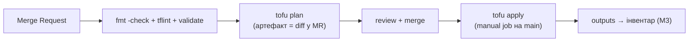

> Документ попередньої версії проєкту (до 09.2026), не відображає поточну архітектуру.

# M2 — Provisioning (Day-0): Terraform + Proxmox

> Статус: план. Передумова: M1 ✅ (iac-runner з OpenTofu 1.12.1, модель даних, mon-01).
> Мета: декларативно створювати VM з коду на Proxmox через OpenTofu, зі станом у GitLab і dry-run у CI. Це шар Day-0 з ARCHITECTURE.md §2.2.

## Чому це зараз

M1 дав середовище й модель наміру. M2 робить перший крок «код → реальний ресурс»: OpenTofu піднімає VM на Proxmox. На цьому шарі вперше працює state, граф залежностей і `plan` як артефакт MR. Далі (M3+) Ansible конфігуруватиме саме ці VM.

## Обсяг

### 1. Backend стану в GitLab

- **GitLab-managed Terraform state** (HTTP backend з locking і версіонуванням) — без S3/MinIO (ADR-002).
- Окремий state на середовище: `staging`, згодом `production`.
- Перевірка: одночасний `plan` з двох місць → lock спрацьовує.

### 2. Модуль `terraform/modules/proxmox-vm`

- Provider `bpg/proxmox` (ADR-001), автентифікація через API-токен `terraform@pve!tofu` (готовий з M0), токен — у CI variable (masked+protected).
- Вхід: ім'я, vCPU, RAM, диск, мережа (bridge/VLAN tag), cloud-init (user, SSH-ключі, IP), вузол-таргет (`pve-a`/`pve-b`), шаблон-джерело (Ubuntu 24.04, VMID 9000).
- Вихід: VMID, IP, ім'я — для подальшого збирання Ansible-інвентаря.
- `versions.tf` з піннінгом версій provider/OpenTofu.

### 3. Середовище `terraform/environments/staging`

- Опис набору VM стенду (наприклад `srv-01`, `srv-02`) через модуль.
- `terraform.tfvars` + `backend.tf`; чутливе — не в репозиторії.
- Запуск з `iac-runner` у CI.

### 4. Підключення pve-b (другий вузол)

- На ПК: VMware Workstation → VM ~20 ГБ (nested virt) → Proxmox VE (`pve-b`), bridge `vmbr0` (LAN) + `vmbr1` (lab), API-токен.
- Шаблон Ubuntu 24.04 cloud-init на pve-b.
- Той самий модуль `proxmox-vm` створює VM на обох вузлах (різниця — параметр вузла) → перша демонстрація multi-site на реальних двох вузлах.

### 5. CI: стадія `terraform`

- `validate`/`plan` — на кожен MR; `apply` — manual job на `main` (захищено).
- Закриває відкладений з M0 пункт DoD «dry-run у CI».

### 6. Нові рішення під ADR

- **ADR-007** — модель автентифікації Terraform до Proxmox (API-токен vs user/pass; обсяг привілеїв токена; least privilege).
  > Примітка: ADR-006 зарезервовано за запаркованим кандидатом «міграція HQ на micro-PC» (`docs/reports/hardware-2026-06-14.md` §4) — не пишемо, поки рішення не активне.
- За потреби — нотатка про nested-virt продуктивність pve-b (заміри).

## Definition of Done

- [ ] `tofu apply` створює VM з коду на **pve-a** (state у GitLab backend, lock працює).
- [ ] Той самий модуль створює VM на **pve-b** (multi-site доведено).
- [ ] `plan` лягає артефактом у MR; `apply` — manual job на `main`.
- [ ] `outputs` модуля придатні для генерації Ansible-інвентаря (вхід у M3).
- [ ] ADR-007 записаний; піннінг версій зафіксовано.

## Поза M2

Конфігурація створених VM (Linux base, Docker) і генерація інвентаря з `organization.yml` — M3. WireGuard між pve-a↔pve-b як мережа «сайтів» — M3 (мережевий ADR).
