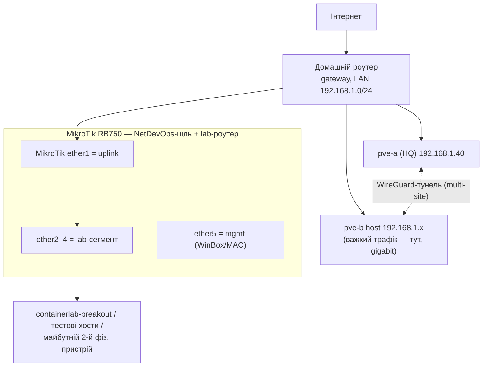

# Апаратна частина стенда: стан на 14.06.2026

Підсумок робіт із залізом і відкриті архітектурні рішення.

## 1. Поточний інвентар заліза

| Вузол / пристрій | Стан | Ключове |
|---|---|---|
| **pve-a (HQ)** | Робочий, **open-bench** | Proxmox VE 9.2, `192.168.1.40`, i3-5005U, **16 ГБ (8+8)**, диск 128 ГБ, 2 ядра. Корпус зруйновано, тільки дротовий Ethernet, старт замиканням падів power-on, далі WoL. |
| **pve-b (філія)** | Вмикається на час експериментів | ПК: 32 ГБ RAM, 1.5 ТБ SSD + 1 ТБ NVMe, Windows + VMware → nested Proxmox. |
| **Домашній роутер** | Робочий | Gateway + DHCP + інтернет, LAN `192.168.1.0/24`, 3 порти як світч. |
| **MikroTik RB750** | Робочий, доступний по мережі | RouterOS **6.48**, **32 МБ RAM**, 5×**100 Мбіт**, 400 МГц 1 ядро. Реальна ціль для NetDevOps. |
| Вільні комплектуючі | На руках | 2×8 ГБ **DDR4** SO-DIMM; 2×8 ГБ **DDR3L** (stranded); SSD з ноута (2.5″ SATA); Samsung SSD з старого ПК (ймовірно 2.5″ SATA). |

## 2. Що вирішено цієї сесії (HW-001…005)

- **HW-001 — WoL.** Resolved (операційно): батарея залишена + AC = standby для NIC, WoL працює. Залишкове обмеження: блекаут довший за автономність → remote-wake залежить від BIOS.
- **HW-002 — 3 блимання Caps Lock, «мертвий» слот RAM.** Fixed: слот був **тугий**, не мертвий → 16 ГБ (8+8) працюють. Планки еквівалентні, CPU тримає 16 ГБ.
- **HW-003 — кулер не крутив.** Fixed: збитий роз'єм вентилятора; рецидив через затиск рештками корпусу.
- **HW-004 — корпус зруйновано → open-bench.** Accepted (стоп-гап): тільки Ethernet, плата на непровідній підкладці, керування по мережі.
- **HW-005 — відірвано шлейф кнопки живлення.** Resolved (workaround): старт замиканням падів power-on на материнці, далі WoL.

Повна діагностика — у `docs/runbooks/hardware-issues.md` + git history.

## 3. Мережа — знахідки й рекомендована схема

**RB750 — оцінка для стенда:**
- ✅ **Ідеальна ціль автоматизації** (Ansible RouterOS-API/SSH, NAPALM `napalm-ros`) — швидкість портів для config-mgmt неважлива. Реальне залізо = сильніший NetDevOps-розділ.
- ⚠️ **Слабкий дата-плейн:** 100 Мбіт (~12 МБ/с) і 32 МБ RAM. **Стеля — RouterOS v6** (v7 на 32 МБ нежиттєздатна) → тулінг обирати під v6.49.x.

**Рекомендована фізична схема** (multi-site дає WireGuard-тунель між вузлами, а не MikroTik):

- Обидва вузли — на швидкому LAN роутера; RB750 — збоку, як керований роутер + ціль IaC.
- **Урок із сесії (для продукту):** заводський дефолт MikroTik блокує керування з боку WAN-порту (firewall input + discovery лише на LAN). Це жива ілюстрація «меж довіри» й ризику «замкнути себе зовні» → обґрунтовує **Safe Mode / dry-run / rollback / ідемпотентність** у плейбуках. Поточний доступ налаштовано вручну (ether1 додано в list=LAN) — згодом винести в IaC.

## 4. Відкриті рішення для планування (ADR-кандидати)

1. **ADR — міграція HQ з ноута на вживаний micro-PC.**
   - *Підстава:* каскад HW-002…005 (зруйнований корпус, повторні поломки), потреба гарантованого remote-wake (vPro/AMT замість крихкого WoL), 6 ядер замість 2 (знімає вузьке місце CI з ADR-001/M0).
   - *Кандидати:* Lenovo M720q/M920q Tiny, Dell OptiPlex Micro 5060/7060, HP EliteDesk 800 G4/G5 Mini. Ціль: i5-8500T/9500T, vPro+Q370 (для AMT).
   - *Реюз активів:* 2×8 DDR4 (16 ГБ), Samsung SSD (2.5″) + ноутбучний SSD, M.2 NVMe докупити за бажанням. Витрата ≈ тільки сам бокс (~7-9 тис. грн, б/у).
   - *Стоп-гап:* поки pve-a в open-bench.
   - *DDR3L-пара* — stranded (тільки під старе залізо), у міграцію не йде.

2. **pve-a знову 16 ГБ → план M0 п.1 дійсний:** повернути ctrl-01 до 8 ГБ і підняти **mon-01 на pve-a** (раніше відкладене обмеження скасовано).

3. **ADR — мережева топологія/автоматизація:**
   - Роль RB750: ціль IaC + lab-роутер, не дата-плейн.
   - Визначити: адресацію lab-сегмента, NAT/firewall, WireGuard HQ↔branch, management-trust (WinBox-MAC як підстраховка).
   - Тулінг під **RouterOS v6** (Ansible `community.routeros`, `napalm-ros`).
   - Гібрид «реальний RB750 + containerlab-емуляція» як цільова демо-топологія.

## 5. Рекомендовані наступні кроки

1. Прийняти/відхилити ADR міграції HQ (бюджет vs строки диплома).
2. Якщо лишаємось на ноуті — зафіксувати open-bench-монтаж і повернути mon-01 на pve-a.
3. Скласти мережевий ADR (адресація + сегменти + тунель) і винести ручні правила MikroTik у плейбук.
4. Узгодити з M3/ADR-003 питання Cisco-образів (containerlab) і фізичного MikroTik (вже є — RB750).
