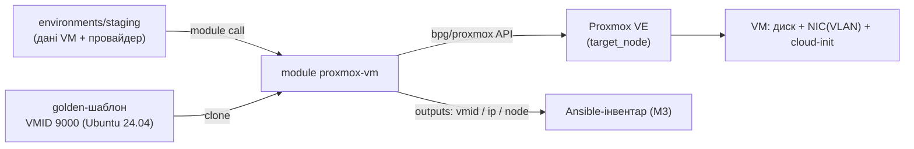

# Модуль `proxmox-vm`

Створює одну віртуальну машину на Proxmox VE клонуванням golden-шаблона
(cloud-init Ubuntu 24.04) і повертає дані для збирання Ansible-інвентаря (M3).
Той самий модуль обслуговує **обидва вузли** (`pve-a`, `pve-b`) — різниця лише
в параметрі `target_node`, що й дає multi-site (профіль M, CONCEPT §4).

> Провайдер: `bpg/proxmox ~> 0.109.0`. Автентифікація — API-токен (ADR-007),
> конфігурується у середовищі (`environments/<env>`), не в модулі.

## Потік



## Приклад використання

```hcl
module "srv_01" {
  source = "../../modules/proxmox-vm"

  name          = "srv-01"
  target_node   = "pve-a"
  template_vmid = 9000

  vcpu          = 2
  memory_mb     = 2048
  disk_gb       = 25
  datastore_id  = "local-lvm"

  network_bridge = "vmbr0"
  vlan_id        = 30 # servers VLAN

  ip_address  = "192.168.1.61/24"
  gateway     = "192.168.1.1"
  dns_servers = ["192.168.1.1", "1.1.1.1"]

  ci_user         = "ansible"
  ssh_public_keys = [trimspace(file("~/.ssh/iac_ci.pub"))]

  tags = ["staging", "linux", "iac-managed"]
}
```

## Входи (основні)

| Змінна | Тип | Деф. | Опис |
|---|---|---|---|
| `name` | string | — | DNS-ім'я VM (стане hostname). |
| `target_node` | string | — | Вузол Proxmox (`pve-a` / `pve-b`). |
| `template_vmid` | number | — | VMID шаблона-джерела (9000). |
| `vm_id` | number | `null` | Фіксований VMID або автоприсвоєння. |
| `vcpu` / `cpu_type` | number/string | `1` / `x86-64-v2-AES` | CPU. |
| `memory_mb` / `memory_floating_mb` | number | `1024` / `0` | Пам'ять і балунінг. |
| `disk_gb` / `datastore_id` / `disk_discard` | number/string | `20` / `local-lvm` / `on` | Системний диск scsi0. |
| `network_bridge` / `vlan_id` / `network_model` | string/number | `vmbr0` / `null` / `virtio` | Мережа. |
| `ip_address` / `gateway` | string | `dhcp` / `null` | IPv4 (CIDR або dhcp). |
| `dns_servers` / `dns_domain` | list/string | `[]` / `null` | DNS. |
| `ci_user` / `ssh_public_keys` | string/list | `ubuntu` / `[]` | cloud-init доступ. |
| `ci_upgrade` | bool | `false` | apt-upgrade у cloud-init (під API-токеном лише `false`, ADR-007). |
| `agent_enabled` / `started` / `on_boot` | bool | `true` | Життєвий цикл. |
| `tags` / `description` | list/string | `[]` / … | Метадані. |

Повний перелік із валідаціями — у [`variables.tf`](variables.tf).

## Виходи

| Вихід | Опис |
|---|---|
| `vmid` | VMID створеної VM. |
| `name` | Ім'я (hostname). |
| `node` | Вузол розміщення. |
| `configured_ipv4` | Заданий cloud-init IP без маски (детермінований) — для інвентаря M3. |
| `ipv4_addresses` | Фактичні IP від qemu-guest-agent (можуть бути порожні на 1-му apply). |
| `mac_addresses` | MAC-адреси інтерфейсів. |

## Гарантії та запобіжники

- **Валідація входів** (`variables.tf`): діапазон VLAN 1–4094, CIDR/`dhcp` для IP,
  vCPU 1–128, `memory_floating ≤ memory`, DNS-коректність імені.
- **Preconditions** (`main.tf`): статичний IP без `gateway` — помилка ще на `plan`;
  порожні `ssh_public_keys` — помилка (інакше VM недосяжна для Ansible на Day-1).
- **Ідемпотентність**: `tags` сортуються (`sort`), щоб Proxmox не показував хибний
  дрифт; `cpu_type` переносний між вузлами (без прив'язки до `host`).
